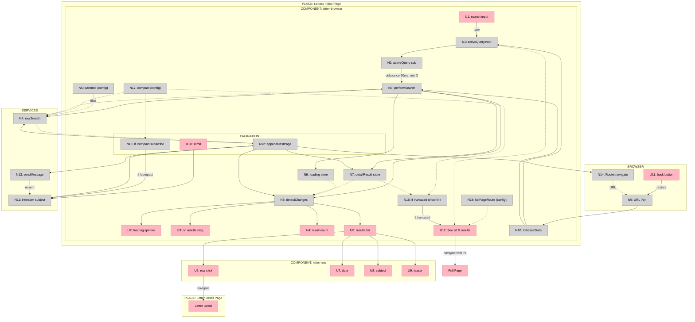
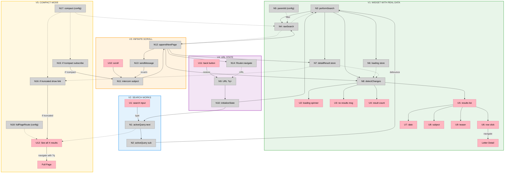

# Example B: Designing from Shaped Parts

## Example B: Designing from Shaped Parts

---

### Part 1: Shaping Context (Input to Breadboarding)

This section shows what comes FROM shaping — the requirements, existing patterns identified, and sketched parts. This is the INPUT that breadboarding receives.

> **Note:** This example uses shaping terminology. In shaping, you define requirements (Rs), identify existing patterns to reuse, and sketch a solution as parts/mechanisms. Breadboarding takes this shaped solution and details out the concrete affordances and wiring.

**The R (Requirements)**

| ID | Requirement |
|----|-------------|
| R0 | Make content searchable from the index page |
| R2 | Navigate back to pagination state when returning from detail |
| R3 | Navigate back to search state when returning from detail |
| R4 | Search/pagination state survives page refresh |
| R5 | Browser back button restores previous search/pagination state |
| R9 | Search should debounce input (not fire on every keystroke) |
| R10 | Search should require minimum 3 characters |
| R11 | Loading and empty states should provide user feedback |

**Existing System with Reusable Patterns (S-CUR)**

The app already has a global search page that implements most of these Rs. During shaping, it was documented at the parts/mechanism level:

| Part | Mechanism |
|------|-----------|
| **S-CUR1** | **URL state & initialization** |
| S-CUR1.1 | Router queryParams observable provides `{q, category}` |
| S-CUR1.2 | `initializeState(params)` sets query and category from URL |
| S-CUR1.3 | On page load, triggers initial search from URL state |
| **S-CUR2** | **Search input** |
| S-CUR2.1 | Search input binds to `activeQuery` BehaviorSubject |
| S-CUR2.2 | `activeQuery` subscription with 90ms debounce |
| S-CUR2.3 | Min 3 chars triggers `performNewSearch()` |
| **S-CUR3** | **Data fetching** |
| S-CUR3.1 | `performNewSearch()` sets loading state, calls search service |
| S-CUR3.2 | Search service builds Typesense filter, calls `rawSearch()` |
| S-CUR3.3 | `rawSearch()` queries Typesense, returns `{found, hits}` |
| S-CUR3.4 | Results written to `detailResult` data store |
| **S-CUR4** | **Pagination** |
| S-CUR4.1 | Scroll-to-bottom triggers `appendNextPage()` via intercomService |
| S-CUR4.2 | `appendNextPage()` increments page, calls search |
| S-CUR4.3 | New hits concatenated to existing hits |
| S-CUR4.4 | `sendMessage()` re-arms scroll detection |
| **S-CUR5** | **Rendering** |
| S-CUR5.1 | `cdr.detectChanges()` triggers template re-evaluation |
| S-CUR5.2 | Loading spinner, "no results", result count based on store |
| S-CUR5.3 | `*ngFor` renders tiles for each hit |
| S-CUR5.4 | Tile click navigates to detail page |

**Sketched Solution: Parts that Adapt S-CUR**

The new solution's parts explicitly reference which S-CUR patterns they adapt:

| Part | Mechanism | Adapts |
|------|-----------|--------|
| F1 | Create widget (component, def, register) | — |
| F2 | URL state & initialization (read `?q=`, restore on load) | S-CUR1 |
| F3 | Search input (debounce, min 3 chars, triggers search) | S-CUR2 |
| F4 | Data fetching (`rawSearch()` with filter) | S-CUR3 |
| F5 | Pagination (scroll-to-bottom, append pages, re-arm) | S-CUR4 |
| F6 | Rendering (loading, empty, results list, rows) | S-CUR5 |

---

### Part 2: Breadboarding (Transform Parts → Affordances)

This is where breadboarding happens. The shaped parts become concrete affordances with explicit wiring. The output is the affordance tables and diagram.

**UI Affordances**

| # | Component | Affordance | Control | Wires Out | Returns To |
|---|-----------|------------|---------|-----------|------------|
| U1 | letter-browser | search input | type | → N1 | — |
| U2 | letter-browser | loading spinner | render | — | — |
| U3 | letter-browser | no results msg | render | — | — |
| U4 | letter-browser | result count | render | — | — |
| U5 | letter-browser | results list | render | → U6, U7, U8, U9 | — |
| U6 | letter-row | row click | click | → LD | — |
| U7 | letter-row | date | render | — | — |
| U8 | letter-row | subject | render | — | — |
| U9 | letter-row | teaser | render | — | — |
| U10 | letter-browser | scroll | scroll | → N11 | — |
| U11 | browser | back button | click | → N9 | — |
| U12 | letter-browser | "See all X results" | click | → LP | — |
| LD | — | Letter Detail | place | — | — |
| LP | — | Full Page | place | — | — |

**Code Affordances**

| # | Component | Affordance | Control | Wires Out | Returns To |
|---|-----------|------------|---------|-----------|------------|
| N1 | letter-browser | `activeQuery.next()` | call | → N2 | → U12 |
| N2 | letter-browser | `activeQuery` subscription | observe | → N3 | — |
| N3 | letter-browser | `performSearch()` | call | → N4, → N6, → N7, → N8 | — |
| N4 | typesense.service | `rawSearch()` | call | — | → N3, → N12 |
| N5 | letter-browser | `parentId` (config) | config | — | → N4 |
| N6 | letter-browser | `loading` store | write | — | → N8 |
| N7 | letter-browser | `detailResult` store | write | — | → N8, → N16 |
| N8 | letter-browser | `detectChanges()` | call | → U2, → U3, → U4, → U5 | — |
| N9 | browser | URL `?q=` | read | → N10 | — |
| N10 | letter-browser | `initializeState()` | call | → N1, → N3 | — |
| N11 | intercom.service | scroll subject | observe | → N12 | — |
| N12 | letter-browser | `appendNextPage()` | call | → N4, → N7, → N8, → N13, → N14 | — |
| N13 | intercom.service | `sendMessage()` | call | → N11 | — |
| N14 | router | `navigate()` | call | — | → N9 |
| N15 | letter-browser | if `!compact` subscribe | conditional | → N11 | — |
| N16 | letter-browser | if truncated show link | conditional | → U12 | — |
| N17 | letter-browser | `compact` (config) | config | — | → N4, → N15, → N16 |
| N18 | letter-browser | `fullPageRoute` (config) | config | — | → U12 |

**Mermaid Diagram**

**Slicing the Breadboard**

With the full breadboard complete, slice it into vertical increments. Each slice demonstrates a mechanism working:

**Slice Summary**

| # | Slice | Mechanism | Affordances | Demo |
|---|-------|-----------|-------------|------|
| V1 | Widget with real data | F1, F4, F6 | U2-U9, N3-N8, LD | "Widget shows real data" |
| V2 | Search works | F3 | U1, N1, N2 | "Type 'dharma', results filter" |
| V3 | Infinite scroll | F5 | U10, N11-N13 | "Scroll down, more load" |
| V4 | URL state | F2 | U11, N9, N10, N14 | "Refresh preserves search" |
| V5 | Compact mode | — | U12, N15-N18, LP | "Shows 'See all' link" |

**Slice Diagram**

## Zusammenspiel bei Flow-Analysen

Bei einer zusammenhängenden Repo-/Agent-Flow-Analyse dem [gemeinsamen Ablauf](../../../../core/repo-flow-analysis/SKILL.md) folgen. Dieser Skill liefert seinen Fachbeitrag; seine Einzelanwendung bleibt eigenständig.
